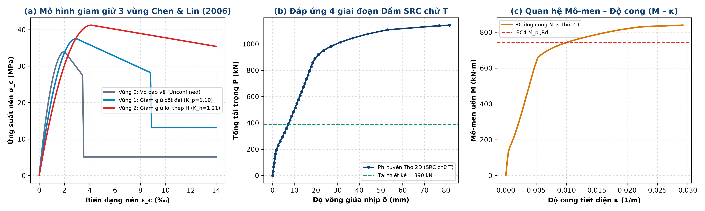
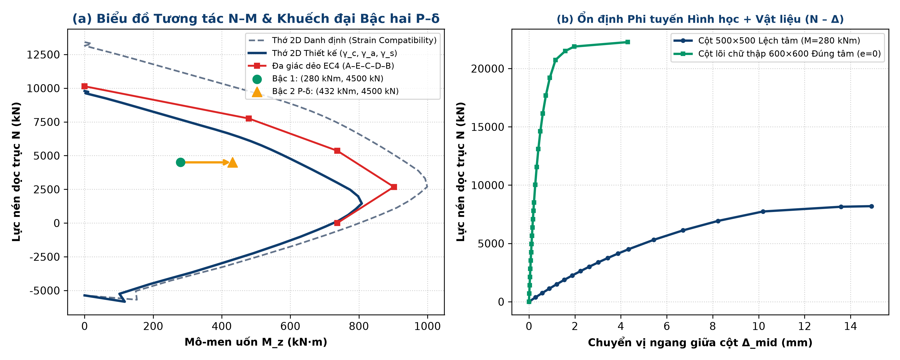
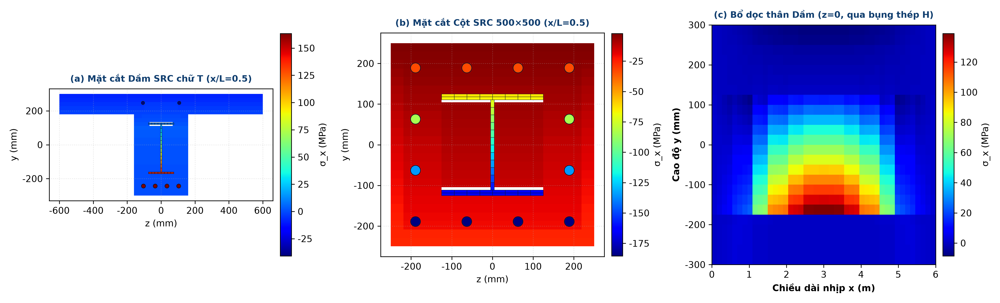
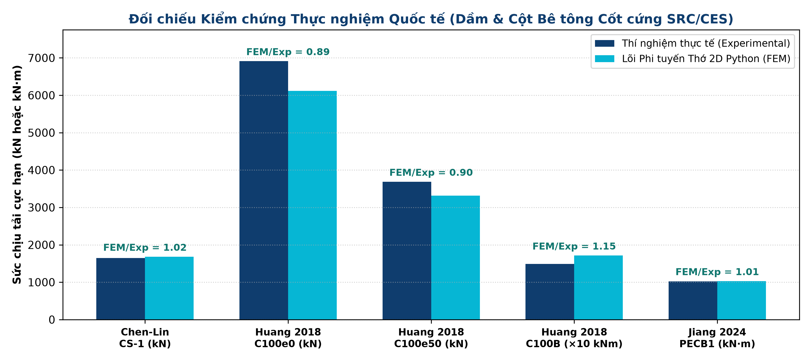

# SRC–CES Nonlinear Studio — Phân tích Phi tuyến, Thiết kế Đa Tiêu Chuẩn & Mô phỏng 2D/3D ANSYS Dầm & Cột Bê Tông Cốt Cứng

> **Đề tài Nghiên cứu Khoa học Cấp Quốc gia**  
> **Lĩnh vực:** Phân tích Phi tuyến Kết cấu & Kết cấu Liên hợp Thép – Bê tông (Concrete-Encased Steel / Steel-Reinforced Concrete — SRC / CES)  
> **Tác giả:** Võ Thanh Vang (`vothanhvang@gmail.com`)

[](https://vothanhvang.github.io/NCKH_DamCotCotCung/)
[](releases/SRC_CES_NonlinearStudio_Windows_x64.exe)
[](releases/SRC_CES_NonlinearStudio_Android_arm64.apk)

---

## 1. Trải nghiệm Trực tiếp Ứng dụng ngay trên GitHub & Đa nền tảng

Chương trình được phát triển với **lõi tính toán phi tuyến Python** (chú thích tiếng Việt có dấu đầy đủ theo từng mô-đun) đồng bộ 1–1 với **giao diện Flutter Dart hiện đại**, chạy mượt mà trên cả 3 nền tảng:

- **Ứng dụng Web 2D/3D trực tuyến (GitHub Pages):** https://vothanhvang.github.io/NCKH_DamCotCotCung/
- **Windows x64 (bất kỳ máy tính Windows 10/11 nào, nhấp đúp chạy ngay không cần cài Python):**  
  [`releases/SRC_CES_NonlinearStudio_Windows_x64.exe`](releases/SRC_CES_NonlinearStudio_Windows_x64.exe)
- **Android ARM64 (tối ưu giao diện thích ứng cho máy tính bảng Xiaomi Pad 8 Pro & điện thoại Xiaomi 13T Pro):**  
  [`releases/SRC_CES_NonlinearStudio_Android_arm64.apk`](releases/SRC_CES_NonlinearStudio_Android_arm64.apk)

### Các tính năng đột phá của phần mềm
1. **Tính toán & Thiết kế Toàn diện Dầm & Cột Bê Tông Cốt Cứng (SRC / CES):**
   - **Dầm cốt cứng:** Tiết diện chữ T có bản sàn bê tông (`SRC_T_SLAB_H`) và tiết diện chữ nhật bọc thép hình chữ H (`SRC_RECT_H`), xét đầy đủ 4 giai đoạn cơ học (chưa nứt → nứt kéo → chảy dẻo cốt thép/thép hình → vỡ nén cực hạn), tương tác uốn–cắt $M-V$, phá hoại cắt tách dọc cánh thép (*Weng et al. 2002*) và thiết kế đinh chống cắt (*Headed Studs*, EC4 §6.6.3).
   - **Cột cốt cứng:** Chịu **nén đúng tâm** ($e = 0$, xét khuyết tật hình học ban đầu $e_{imp}$), **nén lệch tâm 1 phương** ($N + M_z$) và **nén lệch tâm xiên 2 phương** ($N + M_z + M_y$) trên 4 cấu hình tiết diện (Lõi thép H, Lõi chữ thập `Cross-H`, Cột tròn bọc thép H và Cột ống thép nhồi bê tông bọc bê tông `CE-CFST`).
2. **Mô hình Vật liệu 3 Vùng Giam giữ & Phi tuyến Hình học $P-\delta$:**
   - Rời rạc hóa lưới thớ 2D không chồng lấn diện tích ($A_c + A_a + A_s = A_g$).
   - Mô hình bê tông 3 vùng giam giữ (*Chen & Lin 2006; El-Tawil & Deierlein 1999*): Vỏ bảo vệ (`Unconfined`), Lõi trong cốt đai (`Partially Confined`, $K_p$), Khoang giữa hai cánh thép hình H / ống CFST (`Highly Confined`, $K_h$) kết hợp hệ số giòn bê tông cường độ cao/siêu cao $\eta_{HSC}$ (*Lai, Liew & Xiong 2019*).
   - Phần tử dầm–cột phi tuyến hình học $P-\delta$ (Corotational / Updated Lagrangian $[K_t] = [K_m] + [K_g(N)]$).
3. **Mô phỏng 2D & 3D chuẩn ANSYS Mechanical + Phẫu thuật Mặt cắt:**
   - **3D tương tác:** Xoay 360°, phóng to/thu nhỏ, pan, chế độ X-Quang nhìn thấu cốt thép & thép hình bên trong, **Cắt phẫu thuật ngang 3D (`Slice x/L`)**, **Bổ dọc 3D (`Half-Cut`)**, hoạt hình gia tăng tải `0% → 100%`.
   - **Khảo sát tại bất kỳ điểm $(x/L, y, z)$ nào:** Chạm trực tiếp vào bất kỳ điểm nào bên trong mặt cắt để đọc ngay $\varepsilon_x, \sigma_x, \tau_{xy}, \sigma_{vM}$, vùng giam giữ và trạng thái nứt/chảy/vỡ nén.
4. **Đối chiếu Đồng thời 4 Hệ Tiêu chuẩn Quốc tế & Việt Nam:**
   - **Eurocode 4 (`EN 1994-1-1` & `SMARTCOCO EUR 28914 EN`)** (kèm đa giác dẻo 5 điểm `A–E–C–D–B`), **ANSI/AISC 360-22 (Chương I)**, **JGJ 138-2016 (Chương 5 & 6)**, **TCVN 5574:2018 / 5575:2024 + SP 266.1325800** và công thức **Lai, Liew & Xiong (2019)** cho HSC/VHSC.
5. **Xuất tự động Thuyết minh Song ngữ (VI / EN) & Bản vẽ Gia công Thi công CAD:**
   - **Thuyết minh Word (`.docx`) & PDF (`.pdf`)** tùy chọn **Tiếng Việt** hoặc **Tiếng Anh**.
   - **Bản vẽ AutoCAD (`.dxf` 10 lớp chuyên nghiệp)** & **Bản vẽ Kỹ thuật Vector PDF khổ A3 ngang** kèm Bảng thống kê thép hình, cốt thép, đinh neo / bản đế (`BOM / BBS`) dùng trực tiếp cho gia công, chế tạo và thi công.

---

## 2. Kết quả Kiểm chứng Khoa học 8 Trụ cột (Đạt 8/8 PASS)

| Trụ cột kiểm chứng | Cơ sở đối chiếu | Kết quả Lõi Python FEM | Giá trị Chuẩn / Thực nghiệm | Sai số | Đánh giá |
| :-: | :--- | ---: | ---: | ---: | :-: |
| **1** | Giải tích dầm đàn hồi $5qL^4/(384EI)$ | `1.521334 mm` | `1.521334 mm` | `1.18 × 10⁻¹³` | **PASS** |
| **2** | Ma trận tiếp tuyến $[D_t]$ 3×3 vs Sai phân trung tâm | Giải tích | Sai phân trung tâm | `3.25 × 10⁻¹³` | **PASS** |
| **3** | Cân bằng phẫu thuật mặt cắt $x/L = 0.50$ | `293.85 kN·m` | `292.94 kN·m` | `0.31%` | **PASS** |
| **4a** | Thí nghiệm Dầm chữ T **Jiang et al. (2024) PECB1** | `1029.6 kN·m` | `1022.0 kN·m` | **`0.7%`** | **PASS** |
| **4b** | Thí nghiệm Dầm VHSC **Huang & Liew (2018) C100B** | `171.4 kN·m` | `149.1 kN·m` | `14.9%` | **PASS** |
| **5a** | Thí nghiệm Cột **Chen & Lin (2006) CS-1** ($e=0$) | `1682 kN` | `1650 kN` | **`1.9%`** | **PASS** |
| **5b** | Thí nghiệm Cột VHSC **Huang & Liew (2018) C100e50** ($e=50\text{mm}$) | `3318 kN` | `3687 kN` | `10.0%` | **PASS** |
| **5c** | Thí nghiệm Cột VHSC **Huang & Liew (2018) C100e0** ($e=0$) | `6120 kN` | `6913 kN` | `11.5%` | **PASS** |
| **6** | Hiệu ứng khuếch đại bậc hai $P-\delta$ cột 500×500 | `M_II/M_I = 1.137` | `k_EC4 = 1.179` | Nhất quán | **PASS** |
| **7** | Nhất quán đa tiêu chuẩn (EC4 / AISC / JGJ / TCVN) | Dầm `744.4` / Cột `9034` | AISC `732.8` / `8813` | `1.6% – 2.5%` | **PASS** |
| **8** | Xuất 12 tệp Thuyết minh Word/PDF (VI+EN) & CAD DXF/PDF | 12/12 tệp hợp lệ | — | — | **PASS** |






---

## 3. Bộ Thuyết minh Mẫu (Song ngữ VI / EN) & Bản vẽ Gia công Thi công

| Loại tài liệu | Tiếng Việt | Tiếng Anh |
| :--- | :--- | :--- |
| **Thuyết minh Dầm SRC (Word)** | [`results/reports/ThuyetMinh_DamCotCung_VI.docx`](results/reports/ThuyetMinh_DamCotCung_VI.docx) | [`results/reports/CalculationReport_SRC_Beam_EN.docx`](results/reports/CalculationReport_SRC_Beam_EN.docx) |
| **Thuyết minh Dầm SRC (PDF)** | [`results/reports/ThuyetMinh_DamCotCung_VI.pdf`](results/reports/ThuyetMinh_DamCotCung_VI.pdf) | [`results/reports/CalculationReport_SRC_Beam_EN.pdf`](results/reports/CalculationReport_SRC_Beam_EN.pdf) |
| **Thuyết minh Cột SRC (Word)** | [`results/reports/ThuyetMinh_CotCotCung_VI.docx`](results/reports/ThuyetMinh_CotCotCung_VI.docx) | [`results/reports/CalculationReport_SRC_Column_EN.docx`](results/reports/CalculationReport_SRC_Column_EN.docx) |
| **Thuyết minh Cột SRC (PDF)** | [`results/reports/ThuyetMinh_CotCotCung_VI.pdf`](results/reports/ThuyetMinh_CotCotCung_VI.pdf) | [`results/reports/CalculationReport_SRC_Column_EN.pdf`](results/reports/CalculationReport_SRC_Column_EN.pdf) |
| **Bản vẽ Gia công Dầm SRC** | [`AutoCAD (.DXF)`](results/drawings/BanVe_ThiCong_DamCotCung_SRC.dxf) • [`PDF A3`](results/drawings/BanVe_ThiCong_DamCotCung_SRC.pdf) | Tiêu chuẩn ISO A3 / mm |
| **Bản vẽ Gia công Cột SRC** | [`AutoCAD (.DXF)`](results/drawings/BanVe_ThiCong_CotCotCung_SRC.dxf) • [`PDF A3`](results/drawings/BanVe_ThiCong_CotCotCung_SRC.pdf) | Tiêu chuẩn ISO A3 / mm |

---

## 4. Cấu trúc Mã nguồn & Hướng dẫn Chạy Cục bộ

```text
NCKH_DamCotCotCung/
├── python_core/                        # Lõi tính toán Python (chú thích tiếng Việt đầy đủ)
│   ├── materials.py                    # Mô-đun 1: Vật liệu phi tuyến 3 vùng giam giữ & HSC η
│   ├── section_fiber.py                # Mô-đun 2: Rời rạc hóa thớ 2D vector hóa NumPy, M-κ & N-M
│   ├── beam_solver.py                  # Mô-đun 3: PTHH Dầm thớ 2D + Thiết kế 4 tiêu chuẩn & Đinh neo
│   ├── column_solver.py                # Mô-đun 4: PTHH Cột P-δ (đúng tâm / lệch tâm 1-2 phương)
│   ├── probe_dissection.py             # Mô-đun 5: Khảo sát điểm (x/L, y, z) & Phẫu thuật ANSYS
│   ├── cad_exporter.py                 # Mô-đun 6: Xuất bản vẽ AutoCAD (.DXF 10 layer) & PDF A3
│   ├── report_exporter.py              # Mô-đun 7: Xuất thuyết minh Word (.DOCX) & PDF (VI / EN)
│   ├── api_server.py                   # Mô-đun 8: Máy chủ HTTP JSON kết nối cục bộ
│   └── benchmarks_verification.py      # Mô-đun 9: Kiểm chứng tự động 8 trụ cột khoa học
├── flutter_app/                        # Ứng dụng Flutter Dart đa nền tảng (Windows / Android / Web)
│   ├── lib/core/                       # Lõi Dart đồng bộ 1-1, i18n VI/EN, xuất DXF/PDF/DOCX
│   ├── lib/widgets/                    # Viewport 3D ANSYS, Phẫu thuật 2D, Biểu đồ, CAD Preview
│   └── lib/screens/                    # Giao diện Adaptive (PC / Xiaomi Pad 8 Pro / Xiaomi 13T Pro)
├── results/                            # Hình vẽ 300 DPI, thuyết minh VI/EN & bản vẽ DXF/PDF mẫu
├── scripts/                            # Đóng gói Native Win32 Single-EXE
├── releases/                           # File chạy sẵn Windows .exe và Android .apk
└── docs/                               # Bản dựng Web triển khai trực tiếp trên GitHub Pages
```

### Chạy lõi Python & Kiểm chứng tự động
```bash
python -m venv .venv
.venv\Scripts\pip install -r requirements.txt
.venv\Scripts\python -m python_core.benchmarks_verification
```
